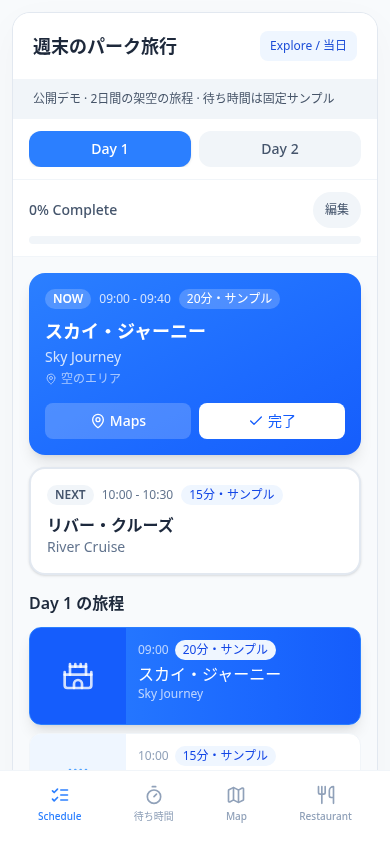
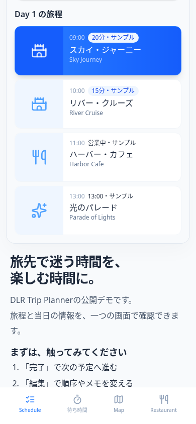
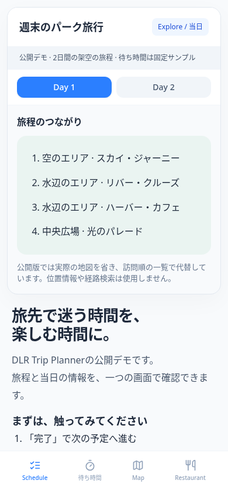
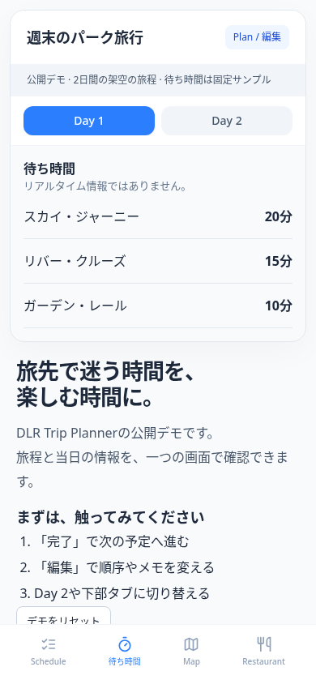
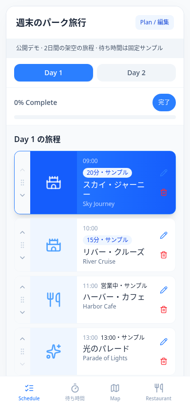

# DLR Trip Planner

A travel-planning UI demo focused on deciding what to do now and next.
Explore a mobile itinerary, edit plans, and switch between sample information tabs.
All places, dates, and wait times in this public demo are fictional.

**旅先で「次に何をするか」をすぐ確認できる、旅程と当日の情報をまとめたアプリ。**

## 課題：機能を増やしても、旅先で迷わず使いたい

準備で作った予定表も、現地では次の予定や場所、待ち時間を何度も見返すことになります。
調べものに時間を使いすぎず、同行者と過ごす時間を大切にしたい。
そのために、一覧や地図、待ち時間の情報を増やしながら、当日の使いやすさを保つことを目指しました。

このリポジトリは、運用版の画面部品を取り出し、架空の旅程で操作できるようにした公開デモです。
公開版と運用版の範囲を分けて紹介します。

## 解決のアプローチ：今の行動を先に、全体の予定はその下に

当日はNOW/NEXTで行動を絞り、旅程一覧で全体を見返せる構成です。
NOWは未完了の先頭、NEXTはその次の予定を示します。時計に合わせた自動判定ではありません。
「完了」を押すと次の予定がNOWに繰り上がり、一覧の取り消し線と進捗にも反映されます。

計画を変更するときは編集モードに切り替えます。NOW/NEXTを隠し、並べ替え・編集・削除の操作を表示します。
情報の種類は下部タブで切り替え、詳細なメモは予定を開いて確認します。

| 設計判断 | 狙い・トレードオフ | 公開コードの根拠 |
| --- | --- | --- |
| NOW/NEXTと一覧を併置 | 今の行動を見つけつつ、その先の予定も見失わない | [状態の選択](src/App.tsx#L15)、[カード](src/features/trip/NowNextCards.tsx#L21)、[一覧](src/features/trip/ScheduleList.tsx#L29) |
| 当日利用と編集を切り替える | 編集操作を常時並べず、目的に合わせて見せる | [編集時のカード非表示](src/features/trip/NowNextCards.tsx#L17)、[並べ替え](src/features/trip/ScheduleList.tsx#L51)、[編集・削除](src/features/trip/ScheduleList.tsx#L116) |
| 日程タブと情報タブを分ける | 日付を選ぶ操作と情報を探す操作を分ける | [DayTabs](src/features/trip/DayTabs.tsx#L30)、[BottomNavigation](src/features/trip/BottomNavigation.tsx#L10) |
| Mapは訪問順、待ち時間は固定サンプル | 外部接続なしで画面操作を試せる。実際の距離や混雑は判断できない | [待ち時間](src/App.tsx#L29)、[Map](src/App.tsx#L30)、[食事候補](src/App.tsx#L31) |

上の狙いは実装と今回の制作方針から整理したものです。過去に比較した案や採用までの経緯は、【哲さん確認：設計時に検討した代替案と、採用を決めた理由】。

## 工夫したところ：公開デモで触れるUI

画像はすべて公開デモの架空データで撮影しています。モバイル画像とGIFの画面サイズは390×844です。

### 今と次の行動を、全体の旅程につなぐ

最初にNOW/NEXTを表示し、下にスクロールすると時刻と種類を伴う旅程一覧が続きます。
完了した予定は一覧に残るため、次の予定と済んだ予定を見比べられます。

| NOW/NEXT | 旅程一覧 |
| --- | --- |
|  |  |

「完了」からNEXTがNOWへ繰り上がる流れです。操作後に進捗も更新されます。


### 情報を切り替えて見る

Mapタブは「旅程のつながり」を訪問順で表示します。実地図・位置情報・経路検索は含みません。
待ち時間タブは架空の固定値を示し、リアルタイム情報ではないと画面内にも明記しています。

| Mapタブ（訪問順の一覧） | 待ち時間タブ（固定サンプル） |
| --- | --- |
|  |  |

### 編集する場面を分ける

編集モードで順序・予定名・メモを変更し、不要な予定を削除できます。
並べ替えは上下ボタンで行い、時刻の枠は維持します（[処理](src/App.tsx#L19)）。ドラッグ操作ではありません。
一覧の詳細はEnter/Spaceでも開け、編集アイコンには操作名を付けています（[実装](src/features/trip/ScheduleList.tsx#L101)）。



### 運用版で取り組んだUI/UX（この公開デモには未収録）

使いやすさを保ちながら機能を増やす方針で、以下の実装にも取り組んでいます。
運用版のコードを読み取りで確認した内容であり、この公開デモで操作できる機能ではありません。運用版は今回起動・撮影していません。

- **待つ時間にも楽しめる入口**：クイズは選択肢への回答、正誤表示、解説へと進みます。施設の詳細には豆知識のタブを設け、予定を確認する流れから読み物にも進める構成です。
- **地図と一覧の行き来**：地図上の施設ピンとリストを組み合わせています。場所を把握する表示と、予定を読む表示を併用する構成です。
- **スワイプで表示量を変える**：地図の下部カードを上下のスワイプで開閉し、詳細の上部を下にスワイプすると閉じられます。ボタンに加え、指の動きでも表示を戻せます。
- **見える印より広く操作を受ける**：地図カードの細いハンドルだけでなく、その周囲の余白を含むヘッダー領域でタップやスワイプを受けます。小さな印を正確に狙う操作を避ける工夫です。

これらの効果を示すユーザーテスト結果や誤タップ削減量は未計測です。公開版にはクイズ・豆知識・スワイプ・実地図・このハンドル領域の実装を移植していません。

## AIの使い方

今回のREADME改稿ではCodexを使い、公開・運用コードの照合、文章の整理、公開デモの撮影、ビルドと画面確認を行いました。アプリの機能追加はしていません。
哲さんが指定したのは、UI/UXを主役にすること、公開範囲の区別、架空データのみの撮影、数値や未実装機能を誇張しないことです。

開発当時の分担はコードだけでは確定できないため、【哲さん確認：開発時に使ったAIツールと任せた作業】、【哲さん確認：哲さん自身が設計・実装・レビューした範囲】を確認事項として残します。

## 品質の担保

CIの検証コマンドは`npm run build`（`tsc --noEmit` + `vite build`）のみです（[設定](.github/workflows/check.yml)）。自動テストは0件です。
今回もNode.js 24でビルド成功を確認しました。Playwrightでの手動確認10項目と検証範囲は[動作確認](docs/verification.md)にまとめています。
利用者調査による使いやすさの改善量、実機タッチ操作、Safari、スクリーンリーダーは未検証です。

## 技術構成と動かし方

React / TypeScript / Tailwind CSS / Viteを使っています（[依存関係とコマンド](package.json)）。
`src/features/trip/`が旅程の画面部品、`src/App.tsx`が公開デモの状態管理、`src/data.ts`が架空の旅程です。

Node.js 24とnpmを用意し、次を実行します。

```sh
npm ci
npm run dev
```

表示されたローカルURLを開き、「完了」→「編集」→Day 2→下部タブの順に試せます。
予定の詳細からスキップ・取り消しも可能です。「デモをリセット」で初期状態に戻ります。

```sh
npm run build
npm run preview
```

**施設名、日程、待ち時間はすべて架空です。** 入力は画面のメモリ内で扱い、再読み込みすると消えます。
認証、共有、Firebase、外部API、位置情報、運用データは含めていません。
このデモで確認できるのは画面の構成と操作です。現地の通信・位置情報の検証結果は含みません。

[改稿前のREADME](docs/readme-original.md) / [来歴・公開用の変更](docs/provenance.md) / [動作確認と制約](docs/verification.md)
