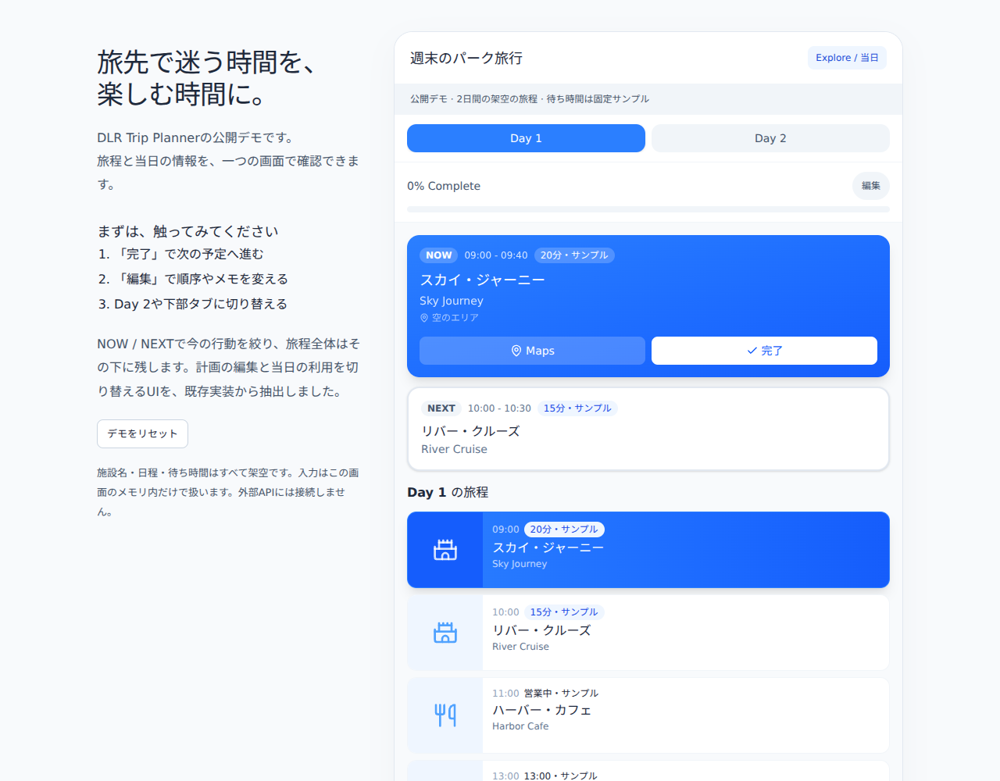

# DLR Trip Planner

旅行中に「次に何をするか」をすぐ決められるように、旅程と当日の情報をまとめたアプリです。
このリポジトリでは、運用版から取り出した画面部品を架空の旅程で試せます。



## 解決したい課題

旅行の準備で作った予定表は、現地に着くと見返しにくくなります。
行きたい場所、次の予定、待ち時間を別々に確認していると、同行者と過ごす時間まで調べものに使ってしまいます。

そこで、計画を編集する場面と、当日の行動を決める場面を分けました。
当日はNOWとNEXTを先に表示し、旅程全体はその下に残しています。
完了した予定を取り消し線と進捗率で示し、次の予定へ進める構成です。

## UI・UXで工夫したこと

画面に出す情報を、旅行中の判断の順番に合わせています。
まず今と次の予定を確認し、必要なときに時刻、場所、メモを開きます。
日程の切り替えと下部のナビゲーションは、旅程を見ながら使える位置に置きました。

編集モードでは、予定の並べ替え、名前とメモの変更、削除ができます。
当日の利用と編集を切り替えることで、操作の目的を分かりやすくしています。
公開版では、主要な操作にキーボードから移動できるようにし、アイコンだけのボタンにも操作名を付けました。

## 試す

Node.js 24とnpmを使います。

```sh
npm ci
npm run dev
```

ターミナルに表示されるローカルURLを開きます。
「完了」でNEXTが繰り上がることを確認したあと、「編集」で予定の順序やメモを変えると、二つの使い方を試せます。
Day 2への切り替えや、予定のスキップと取り消しも可能です。
「デモをリセット」で初期状態に戻ります。

```sh
npm run build
npm run preview
```

ビルド時にTypeScriptの型検査を行います。
確認した操作と制約は[動作確認](verification.md)にまとめています。

## 公開版の範囲

施設名、日程、待ち時間はすべて架空です。
入力は画面のメモリ内で扱い、ページを再読み込みすると消えます。
認証、共有、Firebase、外部API、位置情報、運用データは含めていません。
地図は訪問順の一覧に置き換え、待ち時間は固定のサンプルにしています。

このデモで確認できるのは、画面の構成と操作です。
使いやすさの改善量を示すユーザーテストの結果や、現地での通信・位置情報の検証結果は含みません。

## コードを読む

`src/features/trip/`に、運用版から抽出したNOW/NEXT、日程タブ、旅程リスト、進捗表示、下部ナビゲーションがあります。
`src/App.tsx`は公開デモ用の状態管理、`src/data.ts`は架空の旅程です。
React、TypeScript、Tailwind CSS、Viteを使っています。

抽出元と変更箇所は[来歴](provenance.md)に記載しています。
運用版のGit履歴や設定ファイルは引き継いでいません。
