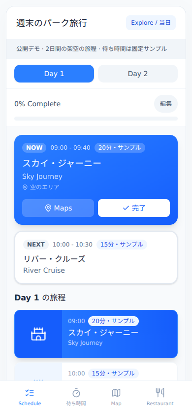

# 動作確認

2026年10月28日、Node.js 24.22.1とChromiumで確認しました。
画面幅は1280×1000と390×844です。
クラウドブラウザからローカルサーバーに接続できなかったため、ローカルのPlaywrightとChromiumを使用しました。

| 確認内容 | 結果 |
| --- | --- |
| TypeScriptの型検査と本番ビルド | 成功 |
| 初期画面の表示 | 成功 |
| 完了後の進捗表示と次の予定への移行 | 成功 |
| Day 2への切り替え | 成功 |
| メモの編集と再表示 | 成功 |
| Enterキーで予定の詳細を開く | 成功 |
| 待ち時間・Map・Restaurantの切り替え | 成功 |
| 初期状態へのリセット | 成功 |
| モバイル幅でページ全体が横にはみ出さない | 確認済み |
| 操作中のJavaScriptエラー | 検出なし |

デスクトップとモバイルのスクリーンショットを目視で確認しました。
日本語の表示、NOW/NEXT、旅程リスト、編集画面、ナビゲーションを確認しています。
スクリーンリーダー、Safari、実機タッチ操作、全組み合わせの状態遷移は未検証です。
この確認は、利用者調査による使いやすさの評価を代替するものではありません。

## 初回PR作成時の再確認（運用版ツアー追加前）

2026年10月28日、Node.js 24.22.1、Playwright 1.59.0、ローカルChromium（chromium-1228）で上表の10項目を再確認しました。Browser plugin not availableのため、Playwrightを使用しました。公開デモの`npm run dev`だけを起動し、運用版は起動・撮影していません。

- `npm ci`と`npm run build`（`tsc --noEmit && vite build`）：成功。自動テストは0件で、テスト用スクリプト・テストファイルはありません。
- 390×844と1280×1000で初期表示と横はみ出しを確認。ページタイトルと主要見出しが表示され、Viteのエラー表示はありませんでした。
- 「完了」でスカイ・ジャーニーからリバー・クルーズへNOWが切り替わり、進捗が25%になることを確認。Day 2、メモ保存・再表示、Enterでの詳細表示、待ち時間・Map・Restaurant、リセットを確認しました。
- 操作中のJavaScript例外・console errorは検出なし。画面確認用の一時スクリプトはリポジトリに含めていません。これは継続実行される自動テストスイートではありません。
- `npm ci`の監査出力には依存関係の脆弱性が2件（moderate 1件、high 1件）ありました。今回のREADME・画像更新では依存関係を変更していません。ビルド成功は脆弱性がないことを意味しません。

README用に[画像](images/)を追加しました。390×844の公開デモのみを撮影し、GIFは「完了」操作前後の画面をつないでいます。画像とGIFの操作前後を開き、架空データだけであること、個人情報・ローカルパス・トークンが写っていないことを目視で確認しました。

## 運用版ツアー追加時の確認

2026年10月28日、運用版の利用者向け画面をローカルで起動して撮影しました。上の初回PR作成時の「運用版は起動・撮影していない」という記録は、その時点の範囲です。今回は撮影の許可を受け、以下の条件で追加確認しました。

- Playwright 1.59.0 / Chromium、viewport 390×844、deviceScaleFactor 2、isMobile・hasTouch有効、iPhone形式のUA。PNGは780×1688、GIFは390×844です。BrowserプラグインがないためローカルPlaywrightを使用しました。
- 秘密情報や.envは読み取らず、認証・Firestoreの旅程取得をローカルスタブへ置換。APIはブラウザ内で固定応答し、外部バックエンドへの要求を遮断しました。外部に許可したブラウザ通信はフォントのGETのみです。タイル・施設コンテンツ・画像素材はローカルにあるものを使用しました。
- 旅程は架空の旅行名・2035年の日程・架空メモです。AI入力画面は撮影時に選んだ別のサンプル日程で、実旅行と無関係です。ユーザーは撮影用、メール・共有コードは非表示、予約番号・トークン・キーは使っていません。施設写真はキャラクター画像に差し替えました。
- クイズ・豆知識・施設紹介は既存の一般向けコンテンツです。解説・歴史に含まれる人名は「制作スタッフ」に置換しました。クイズ選択画面のコンテンツ総数は撮影用表記に置換し、非公開の開発規模は掲載していません。クイズの得点・進捗、一覧件数、待ち時間は画面サンプルであり、利用実績や性能指標ではありません。
- 出題→回答→正解・不正解のフィードバック→解説→次の問題→結果を実際に操作しました。連続正解・ストリーク表示は見つかりませんでした。GIFは主要状態をつないだもので、中間の問題は省略しています。
- Plan/Explore、日程、編集フォーム、チェックリスト、施設詳細、トリビア、DEEP DIVE、情報モード、絞り込み、並べ替え、お気に入り、フォト詳細、表示テーマ、AI入力から確認までを表示・操作しました。撮影セッションでJavaScript例外は検出しませんでした。
- 地図カードと詳細のスワイプはCDPのタッチイベントで実行し、前後の状態を確認しました。実機での誤操作率・操作感・位置精度は未検証です。タップ領域の注釈は、実際のヘッダー要素とハンドル要素のgetBoundingClientRectから撮影時にDOMへ描画しました。
- AI生成・保存、実ログイン、共有参加、外部同期、インポートの実行は未検証です。管理者向け操作は今回の利用者向けツアーの対象外です。「＋プランに追加」はイベント処理を持たないボタン表示、「その他」の管理・改善・記録メニュー等はdisabledなので、実装済みの操作として紹介していません。ライト／ダーク切り替えは操作確認済みです。
- 運用版のソース・スタブ・撮影スクリプト・モックデータは公開repoへコピーしていません。参照cloneにコミット・pushはしていません。
- 公開repoで`npm ci && npm run build`成功。自動テスト0件・CIはbuildのみという記載を維持しています。依存監査の警告2件（moderate 1 / high 1）は継続しており、依存関係は変更していません。
- 今回はNotion・Agent Hub・Slack・メール等への書き込みを行っていません。外部への変更は、許可された公開repoの既存ブランチへのpushと既存PR本文の更新のみです。

### 画像ごとの目視確認

下記は全画像を個別に開いた確認結果です。GIFはファイルを開くほか、変化する各主要フレームも確認しました。全画像で、人名・メール・予約番号・トークン・キー・URLバー・ローカルパスの写り込みがないことを確認しています。人物が写る施設写真は撮影用画像へ置換しています。

| 画像 | 内容 | サイズ（bytes） | 目視確認 |
| --- | --- | ---: | --- |
| [ops/ai-plan-dates.png](images/ops/ai-plan-dates.png) | 日程の選択 | 83,116 | 確認済み：個人情報・秘密情報・URLバー・ローカルパスなし |
| [ops/ai-plan-input.png](images/ops/ai-plan-input.png) | 旅行のテーマ | 87,566 | 確認済み：個人情報・秘密情報・URLバー・ローカルパスなし |
| [ops/ai-plan-pace.png](images/ops/ai-plan-pace.png) | ペース・休憩 | 109,885 | 確認済み：個人情報・秘密情報・URLバー・ローカルパスなし |
| [ops/ai-plan-parks.png](images/ops/ai-plan-parks.png) | パーク・チケット設定 | 98,096 | 確認済み：個人情報・秘密情報・URLバー・ローカルパスなし |
| [ops/ai-plan-review.png](images/ops/ai-plan-review.png) | 生成前の入力確認 | 85,394 | 確認済み：個人情報・秘密情報・URLバー・ローカルパスなし |
| [ops/ai-plan-style.png](images/ops/ai-plan-style.png) | スタイル・優先事項 | 125,203 | 確認済み：個人情報・秘密情報・URLバー・ローカルパスなし |
| [ops/attraction-detail.png](images/ops/attraction-detail.png) | 概要と待ち時間 | 143,865 | 確認済み：個人情報・秘密情報・URLバー・ローカルパスなし |
| [ops/checklist.png](images/ops/checklist.png) | チェックリスト | 133,719 | 確認済み：個人情報・秘密情報・URLバー・ローカルパスなし |
| [ops/detail-swipe.gif](images/ops/detail-swipe.gif) | 詳細の下スワイプ | 124,164 | 確認済み：個人情報・秘密情報・URLバー・ローカルパスなし |
| [ops/edit-form.png](images/ops/edit-form.png) | 予定の編集フォーム | 139,101 | 確認済み：個人情報・秘密情報・URLバー・ローカルパスなし |
| [ops/edit-mode.png](images/ops/edit-mode.png) | 編集モード | 183,243 | 確認済み：個人情報・秘密情報・URLバー・ローカルパスなし |
| [ops/favorites.png](images/ops/favorites.png) | お気に入り一覧 | 52,225 | 確認済み：個人情報・秘密情報・URLバー・ローカルパスなし |
| [ops/home.png](images/ops/home.png) | 撮影用のホーム | 148,270 | 確認済み：個人情報・秘密情報・URLバー・ローカルパスなし |
| [ops/live-attraction-detail.png](images/ops/live-attraction-detail.png) | 施設の詳細 | 199,092 | 確認済み：個人情報・秘密情報・URLバー・ローカルパスなし |
| [ops/map-list.png](images/ops/map-list.png) | 地図と下部の一覧 | 402,481 | 確認済み：個人情報・秘密情報・URLバー・ローカルパスなし |
| [ops/map-modes.png](images/ops/map-modes.png) | 情報の切り替え | 563,720 | 確認済み：個人情報・秘密情報・URLバー・ローカルパスなし |
| [ops/map-schedule.png](images/ops/map-schedule.png) | 旅程を地図で確認 | 590,086 | 確認済み：個人情報・秘密情報・URLバー・ローカルパスなし |
| [ops/map-swipe.gif](images/ops/map-swipe.gif) | 地図カードの上下スワイプ | 362,723 | 確認済み：個人情報・秘密情報・URLバー・ローカルパスなし |
| [ops/now-next.png](images/ops/now-next.png) | 今と次の予定 | 199,313 | 確認済み：個人情報・秘密情報・URLバー・ローカルパスなし |
| [ops/photo-detail.png](images/ops/photo-detail.png) | スポット詳細 | 217,433 | 確認済み：個人情報・秘密情報・URLバー・ローカルパスなし |
| [ops/photo-spots.png](images/ops/photo-spots.png) | フォトスポット一覧 | 204,099 | 確認済み：個人情報・秘密情報・URLバー・ローカルパスなし |
| [ops/quiz-area-select.png](images/ops/quiz-area-select.png) | エリア別 | 92,812 | 確認済み：個人情報・秘密情報・URLバー・ローカルパスなし |
| [ops/quiz-attraction-select.png](images/ops/quiz-attraction-select.png) | 地図から施設を選ぶ | 606,600 | 確認済み：個人情報・秘密情報・URLバー・ローカルパスなし |
| [ops/quiz-correct.png](images/ops/quiz-correct.png) | 正解と解説 | 133,166 | 確認済み：個人情報・秘密情報・URLバー・ローカルパスなし |
| [ops/quiz-flow.gif](images/ops/quiz-flow.gif) | 出題から正解・不正解の解説、進捗、結果へ進むクイズ | 355,737 | 確認済み：個人情報・秘密情報・URLバー・ローカルパスなし |
| [ops/quiz-hub.png](images/ops/quiz-hub.png) | クイズの入口 | 152,773 | 確認済み：個人情報・秘密情報・URLバー・ローカルパスなし |
| [ops/quiz-incorrect.png](images/ops/quiz-incorrect.png) | 不正解にも解説 | 144,007 | 確認済み：個人情報・秘密情報・URLバー・ローカルパスなし |
| [ops/quiz-park-select.png](images/ops/quiz-park-select.png) | パーク別 | 92,128 | 確認済み：個人情報・秘密情報・URLバー・ローカルパスなし |
| [ops/quiz-progress.png](images/ops/quiz-progress.png) | 次の問題と進捗 | 87,127 | 確認済み：個人情報・秘密情報・URLバー・ローカルパスなし |
| [ops/quiz-question.png](images/ops/quiz-question.png) | 出題・回答の選択肢 | 86,178 | 確認済み：個人情報・秘密情報・URLバー・ローカルパスなし |
| [ops/quiz-result.png](images/ops/quiz-result.png) | 結果・再挑戦の導線 | 306,809 | 確認済み：個人情報・秘密情報・URLバー・ローカルパスなし |
| [ops/quiz-start.png](images/ops/quiz-start.png) | スタート | 149,693 | 確認済み：個人情報・秘密情報・URLバー・ローカルパスなし |
| [ops/restaurant-detail.png](images/ops/restaurant-detail.png) | レストラン詳細 | 234,055 | 確認済み：個人情報・秘密情報・URLバー・ローカルパスなし |
| [ops/restaurants.png](images/ops/restaurants.png) | レストラン一覧 | 79,608 | 確認済み：個人情報・秘密情報・URLバー・ローカルパスなし |
| [ops/schedule-list.png](images/ops/schedule-list.png) | 旅程一覧 | 255,764 | 確認済み：個人情報・秘密情報・URLバー・ローカルパスなし |
| [ops/settings-dark.png](images/ops/settings-dark.png) | ダーク表示へ切り替えたその他画面 | 67,861 | 確認済み：個人情報・秘密情報・URLバー・ローカルパスなし |
| [ops/settings-light.png](images/ops/settings-light.png) | その他・表示設定 | 63,905 | 確認済み：個人情報・秘密情報・URLバー・ローカルパスなし |
| [ops/shows.png](images/ops/shows.png) | ショーの一覧 | 57,281 | 確認済み：個人情報・秘密情報・URLバー・ローカルパスなし |
| [ops/sort-options.png](images/ops/sort-options.png) | 並べ替えの選択肢 | 122,825 | 確認済み：個人情報・秘密情報・URLバー・ローカルパスなし |
| [ops/tap-target.png](images/ops/tap-target.png) | ハンドルのタップ領域 | 588,306 | 確認済み：個人情報・秘密情報・URLバー・ローカルパスなし |
| [ops/trivia-deep-dive.png](images/ops/trivia-deep-dive.png) | 観察ポイント | 246,248 | 確認済み：個人情報・秘密情報・URLバー・ローカルパスなし |
| [ops/trivia-detail.png](images/ops/trivia-detail.png) | 詳細内の豆知識 | 141,602 | 確認済み：個人情報・秘密情報・URLバー・ローカルパスなし |
| [ops/trivia-reading.png](images/ops/trivia-reading.png) | 豆知識・歴史・技術を読む | 159,696 | 確認済み：個人情報・秘密情報・URLバー・ローカルパスなし |
| [ops/wait-filter.png](images/ops/wait-filter.png) | 待ち時間で絞り込む | 78,328 | 確認済み：個人情報・秘密情報・URLバー・ローカルパスなし |
| [ops/wait-history.png](images/ops/wait-history.png) | 待ち時間の推移表示 | 117,004 | 確認済み：個人情報・秘密情報・URLバー・ローカルパスなし |
| [ops/wait-times.png](images/ops/wait-times.png) | 待ち時間の一覧 | 102,820 | 確認済み：個人情報・秘密情報・URLバー・ローカルパスなし |
